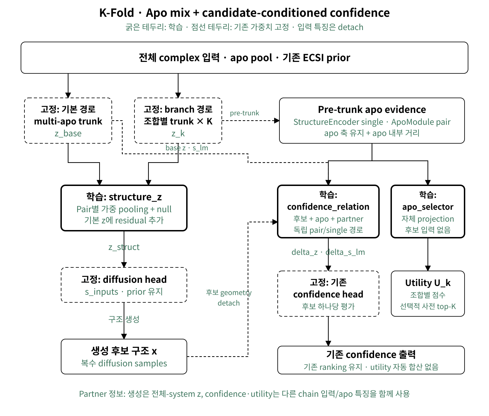

# Apo joint inference 인수인계

main을 알고 있는 팀원을 위한 변경점과 실행 가이드다. 기능 구현 기준은
`e936d5eac8ec03ec2137950fb12a90cf868f51ab`, 전달 브랜치는
`codex/apo-joint-inference-controls`다. 이 문서와 실행 wrapper를 추가한 최종
전달 커밋은 Messi 패키지의 `manifests/source.json`에 기록한다.

## main에서 달라진 부분



- **구조 생성 경로:** 기존 base trunk에 더해 apo 조합별 frozen trunk를 실행한다.
  학습한 `structure_z` residual mixer가 branch pair 표현을 합쳐 기존 diffusion
  head에 전달한다. 따라서 **생성 구조도 달라진다**. Diffusion head 자체의
  기존 가중치를 추가 학습한 것은 아니다.
- **Confidence 경로:** apo별 pre-trunk structure/ApoModule 표현과 생성 후보의
  geometry를 learned pair/single relation adapter로 결합해 기존 confidence head에
  넣는다. Structure mixer와 별개 파라미터를 사용한다.
- **Utility selector:** 별도 projection으로 apo branch utility를 학습한다.
  기본 CLI에서는 utility top-k 선별을 켜지 않으며, utility가 기존 ranking score에
  가산되지 않는다. Python API의 `apo_selection_top_k`는 별도 실험 옵션이다.
- 원래 71K 전체 EMA에서 시작해 기존 encoder/trunk/diffusion/confidence 가중치는
  고정하고 새 adapter를 학습했다. Shallow는 relation depth 1, Deep은 3이다.
  상세 구현·학습 설명은 [기존 기술 문서](apo_joint_relation.md)에 있다.

그림의 branch는 단백질 하나가 아니라 **전체 complex의 apo 배정 조합**이다.
조합 상한 3은 출력 sample 수가 아니다. seed당 출력은 그대로 5개다.

## 전달 파일

Messi 소유자 전달 경로:

```text
/home/hwkim/kfold-handoff/apo-joint-20261109/
├── source/                     # 이 브랜치의 추론 소스·설정·문서·테스트
│   ├── run_kfold.py
│   ├── src/kfold/
│   ├── scripts/run_apo_joint_inference.sh
│   └── docs/handoff_apo_joint_inference.md
├── models/
│   ├── apo-joint-shallow-update3000/
│   ├── apo-joint-shallow-update4000/
│   ├── apo-joint-shallow-update10000/
│   └── apo-joint-deep-update4000/
└── manifests/                  # 커밋, 파일별 SHA256, 모델 provenance
```

각 모델 디렉터리는 `config.yaml`, **`weights/kfold.pth`**, 원래
`export_receipt.json`을 포함한다. `kfold.pth`는 추론용 전체 EMA state dict다.
Optimizer와 학습 재개 상태를 가진 `.ckpt`는 이 전달 패키지에 포함하지 않는다.
원래 checkpoint SHA는 model manifest에 별도로 기록한다. 모델 총량은 약 5.44 GB다.
공개 가능한 모델별 SHA는 [모델 manifest](apo_joint_models_20261109.json)에 있다.
전달본 전체 파일은 Messi에서 다음처럼 검증한다.

```bash
cd /home/hwkim/kfold-handoff/apo-joint-20261109
sha256sum -c manifests/SHA256SUMS
```

| 모델 | relation depth | 용도 |
| --- | ---: | --- |
| Shallow3K | 1 | 기존 seed1–10 평가에 사용한 모델 |
| Shallow4K | 1 | 기존 seed1–10 평가에 사용한 모델; 아래 예제 기준 |
| Deep4K | 3 | 기존 seed1–10 평가에 사용한 별도 구조 |
| Shallow10K | 1 | 최신 Shallow export; best 모델이라는 뜻은 아님 |

하나의 모델로 AF2/AtlasFold × mix/single 네 조건을 실행한다. 네 조건별로
다른 모델 가중치를 고르는 방식이 아니다. Encoder·AtlasFold·CCD 등 main에서 쓰던
외부 자산 전체는 이 5.44 GB에 포함되지 않으며 기존 환경/캐시가 필요하다.

소스와 모델은 함께 사용한다. main/PyPI의 기존 코드에 새 weight만 연결하거나,
config에서 adapter를 꺼서 억지로 로드하지 않는다. Messi 기존 checkout·환경은
수정하지 않았다. 이 경로는 소유자 home 안의 전달본이며 다른 계정에 대한 공유
권한이 설정됐다는 뜻은 아니다.

## 설정 차이와 주의점

| 항목 | 이 모델 실행값 | main 사용자에게 필요한 변경 |
| --- | --- | --- |
| 모델 | 전달된 로컬 모델 디렉터리 | **`--model-path` 필수**. 생략하면 기본 pretrained 모델을 사용한다. |
| 모델 config | export에 동봉된 `config.yaml` | `apo_repr_mix.enabled=true`, `weighted_structure=true`, `max_combinations=3`, `relation_depth=1 또는 3`. 학습 YAML을 추론 config로 대신 쓰지 않는다. |
| Apo mix | `--apo-trunk --apo-trunk-recycles 2` | 추가 branch trunk와 post-trunk structure mixer 사용 |
| Single trunk | `--no-apo-trunk` | 추가 branch trunk/mixer를 우회. **학습된 pre-trunk confidence/utility adapter는 유지** |
| Base trunk | `--num-recycles 10` | single은 trunk 호출 1회라는 뜻이지 recycle 1이 아니다. |
| Branch 상한 | `--max-apo-combinations 3` | whole-complex apo 조합 상한 |
| 샘플링 | `--num-samples 5 --num-steps 100` | seed1–5와 seed1–10은 아래 seed 목록으로 지정 |
| Apo 구조 encoder | 켬 | `--disable-struct-encoder`를 사용하지 않는다. |

새 세 가지 trunk 제어 옵션은 main CLI에 없는 옵션이다. `apo_trunk_recycles=0`도
추가 trunk의 initial pass는 실행하므로 OFF와 다르다. `--no-apo-trunk`는 main
baseline 복원이 아니며, “generation만 켜기/confidence만 끄기”용 독립 CLI 스위치는
현재 제공하지 않는다.

기존 Python >=3.11/CUDA용 main 환경에서 이 source를 사용한다. 추가 추론 의존성은
없고, 학습 전용 Lightning/LMDB 설치는 필요 없다. `atlasfold` 등 버전 요구는
이 브랜치의 `pyproject.toml`을 따른다. 기존 main editable install을 덮어쓸 필요 없이
wrapper가 전달본 `src`를 `PYTHONPATH` 맨 앞에 넣고 실제 import 경로를 확인한다.
`KFOLD_PYTHON`에는 **실제 준비된 환경의 Python**을 지정한다.

## 네 가지 조건 실행

### Apo source는 입력 파일로 선택

`--apo-source af2` 같은 새 옵션은 없다. AF2 조건에는 기존 main과 동일한 query
schema의 `apo` 목록으로 AF2 PDB/mmCIF를 제공한다. AtlasFold 조건에는 AtlasFold
구조를 제공하거나, `apo`를 생략해 기존 자동 생성 단계를 사용한다. 아래는 한
protein entry 예시이며 실제 complex의 나머지 분자 entry는 그대로 포함한다.

```yaml
name: example_complex
sequences:
  - protein:
      id: A
      sequence: MKTAYIAKQRQISFVKSHFSRQLEERLGLIEVQANL
      apo:
        - structures/af2_apo_0.pdb
        - structures/af2_apo_1.pdb
        - structures/af2_apo_2.pdb
```

상대 경로는 query 파일 위치 기준이다. 구조의 sequence/chain 대응을 맞춘다.
동일 apo ensemble로 생성 seed만 비교하려면 양 조건에 같은 ensemble을 명시한다.
AtlasFold 자동 생성은 seed별 apo도 바꿀 수 있으므로 “seed 효과”만 분리한 실험과
같지 않다. 기존 FoldBench context/prior 순서·seed별 배정을 재현하려면 당시 준비된
query/apo/prior metadata도 필요하다. 일반 CLI 예제만으로 동일 benchmark 입력까지
재현됐다고 해석하지 않는다. Apo 후보 제한/`prior` 상세는 [입력 문서](inference.md#apo-structures)를 참고한다.

### 동일 checkpoint, source × trunk 비교

아래 명령은 **GPU 추론을 시작한다**. Messi에서는 다음 절의 Slurm 할당과 node-local
staging을 먼저 수행한다. `work`는 아래 절에서 만든 node-local 작업 디렉터리다.

```bash
export KFOLD_PYTHON=/absolute/path/to/prepared/env/bin/python
SOURCE="$work/source"
MODEL="$work/models/apo-joint-shallow-update4000"

# query_af2.yaml / query_atlas.yaml 및 apo/prior 파일은 $work/input에 준비
bash "$SOURCE/scripts/run_apo_joint_inference.sh" "$MODEL" mix \
  "$work/input/query_af2.yaml" "$work/out/af2-mix" --seeds 1 2 3 4 5 --gpu-ids 0
bash "$SOURCE/scripts/run_apo_joint_inference.sh" "$MODEL" single \
  "$work/input/query_af2.yaml" "$work/out/af2-single" --seeds 1 2 3 4 5 --gpu-ids 0
bash "$SOURCE/scripts/run_apo_joint_inference.sh" "$MODEL" mix \
  "$work/input/query_atlas.yaml" "$work/out/atlas-mix" --seeds 1 2 3 4 5 --gpu-ids 0
bash "$SOURCE/scripts/run_apo_joint_inference.sh" "$MODEL" single \
  "$work/input/query_atlas.yaml" "$work/out/atlas-single" --seeds 1 2 3 4 5 --gpu-ids 0
```

seed1–10은 각 명령의 목록을 `--seeds 1 2 3 4 5 6 7 8 9 10`으로 바꾸고 별도
output 경로를 사용한다. seed1–5만 필요한 경우 5개 목록을 쓴다. `--seeds` 생략 시
기존 CLI 기본값은 seed1 하나다. checkpoint/mode/입력 설정이 달라지면 새 output
디렉터리를 쓴다. Wrapper는 일부 protocol override와 `--overwrite`를 막는다.
다른 설정을 실험하려면 아래 원래 CLI를 직접 사용하고 설정을 기록한다.

```bash
PYTHONPATH="$SOURCE/src" "$KFOLD_PYTHON" "$SOURCE/run_kfold.py" \
  --model-path "$MODEL" --input "$work/input/query_af2.yaml" \
  --out-dir "$work/out/custom" --stage all \
  --apo-trunk --apo-trunk-recycles 2 --max-apo-combinations 3 \
  --num-recycles 10 --num-samples 5 --num-steps 100 \
  --seeds 1 2 3 4 5 6 7 8 9 10 --gpu-ids 0
```

`--stage all`은 제공된 apo를 준비한 뒤 complex를 예측한다. `--stage complex`만
실행하려면 같은 output 디렉터리에 기존 `--stage apo` 준비본이 먼저 있어야 한다.
빈 output에 외부 apo만 가리키고 complex 단계를 바로 실행하지 않는다.

## Messi에서 실행 준비

이번 전달에서 GPU job을 제출하지 않았다. **CPU 테스트와 파일 복사 검증은
Messi GPU 환경에서의 새 checkpoint 실행 검증을 대신하지 않는다.** 기존 환경을
재설치하지 말고 main이 실행되던 환경/외부 자산을 먼저 확인한다. 다른 프로젝트용
구형 container overlay를 버전 확인 없이 그대로 사용하지 않는다.

Messi 계산은 Slurm으로 할당받고 CPU:GPU=4:1을 유지한다. 예시의 partition은
실제 사용 가능한 GPU partition으로 치환한다.

```bash
salloc -p <GPU_PARTITION> --nodes=1 --ntasks=1 --cpus-per-task=4 \
  --gres=gpu:1 --time=01:00:00
srun --pty bash

# 이후는 할당된 계산 노드 안에서 실행
test -n "${SLURM_JOB_ID:-}"
PACKAGE=/home/hwkim/kfold-handoff/apo-joint-20261109
work="/scratch/$USER/kfold/apo-joint-${SLURM_JOB_ID}"
mkdir -p "$work/models" "$work/input" "$work/out" "$work/cache" "$work/tmp"
cp -a "$PACKAGE/source" "$work/source"
cp -a "$PACKAGE/models/apo-joint-shallow-update4000" "$work/models/"
export TMPDIR="$work/tmp" HF_HOME="$work/cache/huggingface"
export TORCHINDUCTOR_CACHE_DIR="$work/cache/inductor"
export TRITON_CACHE_DIR="$work/cache/triton"
export OMP_NUM_THREADS=1 OPENBLAS_NUM_THREADS=1 MKL_NUM_THREADS=1
```

입력/apo/prior와 필요한 기존 encoder/CCD/AtlasFold 캐시도 정확한 범위만 node-local에
staging한다. 복사 뒤 query의 절대 경로가 home을 계속 참조하지 않는지 확인한다.
노드 scratch 공간은 모델 1개 약 1.36 GB 외에 encoder/cache·입력·출력 여유가 필요하다.
계산 중 반복 I/O는 scratch에서 수행하고, 완료 후 결과·설정·로그를 영구 경로로
한 번 회수해 검증한다. 실패한 scratch 산출물을 자동 삭제하지 않는다.

## 결과를 확인할 때

main과 동일하게 CIF/confidence JSON/summary CSV/seed별 설정이 생성된다.
기본 ranking은 `0.8 * iptm + 0.2 * ptm - 100 * has_clash`이며 utility는 별도다.
Confidence는 정답 구조 정확도 자체가 아니므로 OST/DockQ의 실제 metric과 구분한다.
일반 CLI 출력이 FoldBench 공식 평가나 252개 seed 부분집합 통계까지 수행하는 것은 아니다.
seed1–5는 25후보 고정 선택, seed1–10의 252개 5-seed 조합 분석은 별도 후처리다.
겹치는 252개 조합의 SD는 독립 반복의 신뢰구간이 아니다.

최근 PP 분석에서는 native interface를 `dockq_reference_interfaces`로 정확히 선택해야
하는 기존 집계 문제를 확인했다. 따라서 과거 모든 checkpoint/source의 성공률을 이
구현의 성능 보장으로 인용하지 않는다. 이 전달은 기능·모델·실행 설정의 인수인계다.
